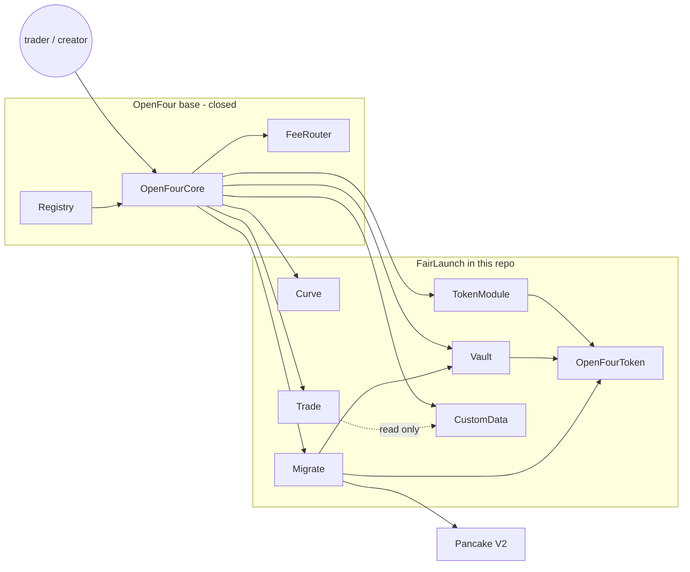
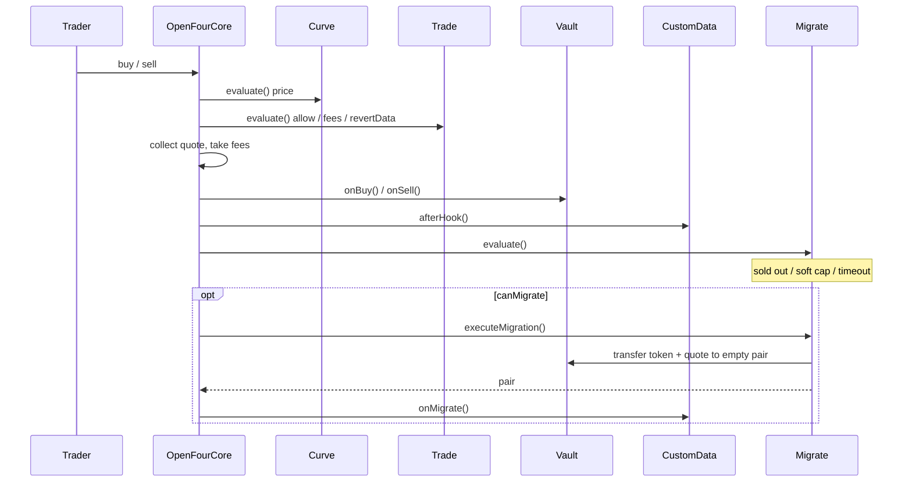
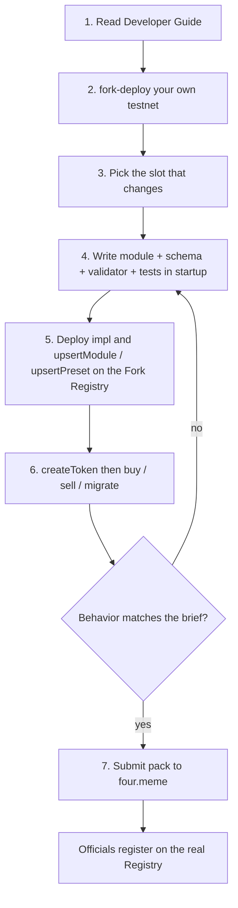

# OpenFour Startup

This directory is the FairLaunch example and the Hardhat starter for new presets. The compile environment matches official OpenFour: solc 0.8.24, optimizer 200, viaIR.

FairLaunch is a fixed-price launch with optional sell support, per-trade and per-address buy limits, post-trade custom data, and migration after sellout, soft cap, or timeout.

Rules and interfaces stay in the [Developer Guide](../../docs/developer-guide.md). This project is the runnable sample: example modules, `OpenFourToken`, a validator, and tests. It does **not** include OpenFourCore, Registry, FeeRouter, or CreateDeployer source.

The samples are unaudited and for development only. Do not use them in production.

## Contents

| Path | Role |
| --- | --- |
| `contracts/interfaces/` | Module / token / Registry / Core / Tools interfaces only |
| `contracts/libraries/OpenFourTypes.sol` | Shared structs |
| `contracts/token/OpenFourToken.sol` | Standard token; custom tokens inherit this |
| `contracts/modules/token/StandardTokenModule.sol` | Token initialization and module wiring |
| `contracts/modules/vault/StandardVault.sol` | Custody and sale accounting |
| `contracts/modules/curve/FairLaunchCurveModule.sol` | Fixed-price curve |
| `contracts/modules/trade/FairLaunchTradeModule.sol` | Trade policy. Ordinary rejection is `allowed=false` plus `revertData` encoded as `error Xxx(...)` via `abi.encodeWithSelector`. Core later calls `OpenFourTypes.revertIfDisallowed`. |
| `contracts/modules/data/FairLaunchCustomDataModule.sol` | Post-trade and post-migration state |
| `contracts/modules/migrate/FairLaunchMigrateModule.sol` | Graduation, then official-style PCS V2 add-liquidity against the real Pancake router on BSC / BSC Testnet (`pair.mint`, LP to `0xdead`). Local Hardhat skips the pool. |
| `contracts/validators/FairLaunchPresetValidator.sol` | Cross-module parameter checks |
| `contracts/helpers/` | Local clone / mock helpers; not part of the protocol |
| `presets/` | One JSON per preset. Copy `fairlaunch.json` — do not copy the JS scripts. |
| `templates/` | Slot skeletons used by `scripts/new-module.js` |

Tax / Tapeout / Stock4 / Uni token references stay under repo-root `contracts/token/`. Do not copy FairLaunch modules back into that tree.

## How the pieces fit

OpenFour is a coordinator plus five required slots (and optional CustomData). This repo does **not** contain Core / Registry / FeeRouter source. Those stay closed. You only write the slot implementations Core already knows how to call.

| Piece | Who owns it | Does | Does not |
| --- | --- | --- | --- |
| `OpenFourCore` | Closed base | Create, route buy/sell, pay fees, switch phase, call migrate | Price, custody policy, graduation rules |
| `Registry` | Closed base | Store module / preset / tokenImpl ids | Run a trade |
| `OpenFourToken` | This repo | ERC20 body, module addresses, `migratedPools` | Price or trade policy |
| `StandardTokenModule` | This repo | `initialize` the token, mint supply to the vault | Trade after create |
| `StandardVault` | This repo | Hold quote + sale inventory, book `totalRaised` / `remainingForSale` / phase | Price or allow/deny a trader |
| `FairLaunchCurveModule` | This repo | View-only fixed price | Write history or hold funds |
| `FairLaunchTradeModule` | This repo | View-only limits / fees / `revertData` | Write counters (reads CustomData) |
| `FairLaunchCustomDataModule` | This repo | After-trade / after-migrate facts | Approve a trade |
| `FairLaunchMigrateModule` | This repo | Decide graduation, add PCS V2 liquidity | Price the inner market |
| `FairLaunchPresetValidator` | This repo | Cross-module create-time checks | Run at buy/sell time |



Core is the only writer of the happy path. Modules answer questions or accept Core-only hooks. They do not call each other to settle a trade.



Create is the same idea: Core reads the Preset, clones token + modules, asks the validator, then calls TokenModule / each `init`. After that, every later buy, sell, and migrate is Core → slot → back to Core.

## Module contract rules

OpenFour modules are per-token clones. Bind exactly one token in `init`, store `fourCore`, and reject any other token.

- Return a stable `descriptor()`. FairLaunch tags look like `module.curve.fair_launch`.
- Modules with encoded params expose `moduleEncodeSchema()`. Schema is UI help only; `init` still decodes and validates.
- Store raw init bytes and expose `getInitParams()` when the interface requires it.
- Hook data is not trusted input. `executeMigration()` must re-check caller, token, conditions, and caps.

## Usage

Compile and unit-test first:

```bash
cd developer/startup
npm install
npx hardhat compile
npx hardhat test
```

To put this FairLaunch example on **your own fork** and run one create / buy / sell loop:

```bash
# 0. Optional: one workspace install from developer/
cd ..
npm run setup                 # copies .env.example and npm install --workspaces

# 1. Create a developer-owned proxy set (once)
cd fork-deploy
cp .env.example .env          # or fill developer/.env
npm run fork

# 2. Register the preset JSON on that Fork Registry
cd ../startup
PRESET=fairlaunch npx hardhat run scripts/register.js --network bsctestnet

# 3. Create a token, buy, sell (schema is read from chain)
PRESET=fairlaunch npx hardhat run scripts/create-and-trade.js --network bsctestnet
```

`scripts/register.js` and `scripts/create-and-trade.js` are generic. The only preset-specific file is `presets/fairlaunch.json` (slots, validator, create params, buy/sell amounts). Output is `out/<PRESET>-registration.json` (from the env / filename, not the JSON `name`). Token impl defaults to the fork bonding implementation.

`reuse: true` looks up that `keySource` (and the official alias when the key is `module.token.standard` / `module.vault.standard`). `reuse: "fork"` uses the fork's standard module for that slot. Do not set `reuse: true` on a new curve/trade/migrate key that is not on the fork yet.

Create amounts: schema `decimals: 18` is a human string (`"0.0001"`, `"80"`); `decimals: 0` is a raw integer (`"1000000000000000000"`). Missing fields use the schema `defaultValue`. Set `loop.sell` to `false` to skip sell.

For your own preset, copy `presets/fairlaunch.json` to `presets/my-play.json` and edit that file. Do not copy the JS scripts.

```bash
cp presets/fairlaunch.json presets/my-play.json
# edit modules / create / loop
SLOT=curve NAME=MyCurveModule TAG=module.curve.my_play PRESET=my-play npx hardhat run scripts/new-module.js
PRESET=my-play npx hardhat run scripts/register.js --network bsctestnet
PRESET=my-play npx hardhat run scripts/create-and-trade.js --network bsctestnet
PRESET=my-play npx hardhat run scripts/pack-submit.js
```

`register-fairlaunch.js` still works as a wrapper that sets `PRESET=fairlaunch`. Both scripts refuse chainId `56` / `4663` and only write the Registry in your `fork.json`. Created tokens are appended to `developer/workbench/data/tokens.json`.

Local-only implementation deploy (no Registry write) is still `scripts/deploy-implementations.js`.

## Starting a new preset here

Do not rewrite all five slots. Change the one responsibility that actually moved, then reuse FairLaunch / the fork's already-registered modules for the rest.



| Step | What you do | Tool |
| --- | --- | --- |
| 1 Docs | Module roles, `revertData`, schema, submit rules | [Developer Guide](../../docs/developer-guide.md) |
| 2 Testnet | New proxies, you are Registry owner and `Core.signer` | `developer/fork-deploy` |
| 3 Scope | Pricing → Curve. Limits / fees → Trade (+ CustomData if you need history). Graduation → Migrate. Token tax / outer market → inherit `OpenFourToken`. Avoid a new Vault. | This README |
| 4 Code | New contract under `contracts/modules/`, `descriptor()` tag, `moduleEncodeSchema()`, Hardhat tests. Compile env stays solc 0.8.24 / optimizer 200 / viaIR. | this directory |
| 5 Register | Copy `presets/fairlaunch.json`, set `PRESET=<id>`, run `scripts/register.js`. `reuse: true` resolves standard aliases (`TOKEN_STANDARD` …). Only write the Registry in your `fork.json`. | `scripts/register.js` or Workbench Register |
| 6 Verify | `createToken` as `Core.signer`, then buy / sell / migrate. Keep the token in `workbench/data/tokens.json`. | `scripts/create-and-trade.js` or Workbench |
| 7 Submit | Source, tag, schema, tests, risk notes, **fork Registry address**. You do not `upsert` mainnet. | Workbench Submit / [four.meme](https://four.meme) |

Typical first preset: copy `FairLaunchCurveModule` or `FairLaunchTradeModule`, rename the tag to `module.curve.my_play` / `module.trade.my_play`, keep Token / Vault / Migrate from this example or from the fork.

Do not change the solc version, optimizer, or viaIR settings.
