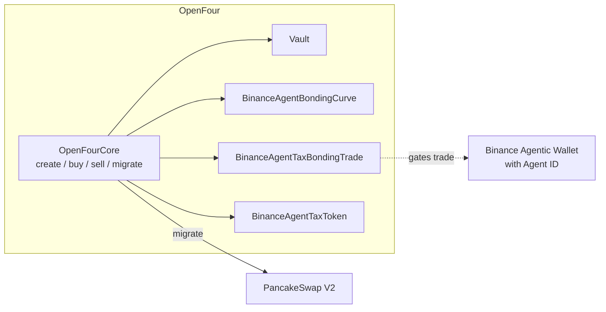

# Binance Agent ID Exclusive

[English](./binance-agent-id-exclusive.md) | [繁體中文](../zh-Hant/mechanisms/binance-agent-id-exclusive.md)

**Binance Agent ID Exclusive** is an OpenFour bonding preset for traders using a **Binance Agentic Wallet with Agent ID**. The ERC20 is **`BinanceAgentTaxToken`, which extends `TaxToken`**: tax collection, dispatch, founder payout, and holder claims follow the same TaxToken lifecycle, with Agent-only gates (0-tax allowed, inner-market transfer lock, hold cap). It caps non-presale buys at **1% of creation `maxSupply` per address**.

This page covers preset-specific mechanics plus a TaxToken tax / claim summary. Shared create / quote / events: [Integration Guide](../integration-guide.md). Full tax lifecycle detail: [TaxToken tax mechanism](./tax-token.md).

`presetId = 1778027615735`

**Requirement:** inner-market buy/sell (except the creator’s create-block presale) needs a **Binance Agentic Wallet with Agent ID**.  
**Create is open:** the token creator does **not** need Agent ID — any EOA may create.

To trade on the inner market, use a **Binance Agentic Wallet** and obtain an **Agent ID**. Enable Developer Mode first:

```text
Binance App → Agentic Wallet Setting → Turn on Developer Mode
```

Then you can trade through Binance Pro AI conversations and other Agentic Wallet flows:

- [ai.binance.com](https://ai.binance.com)
- [Agentic Wallet / AI Pro docs](https://web3.binance.com/en/dev-docs/products/agentic-wallet/ai-pro)

---

## 1. Architecture



```text
Create  → any EOA (no Agent ID required); optional creator create-block presale (≤ raise × 1.5%)
Trading → Binance Agentic Wallet with Agent ID; hold ≤ maxSupply × 1%; transfer lock
Migrate → PCS V2
After   → transfers unlocked; DEX trade; TaxToken tax rules if rates > 0
```

| Stage | Behavior | vs normal Tax bonding |
|-------|----------|------------------------|
| Create | Any EOA may create; **Agent ID not required**; **0/0 tax allowed** | **Different**: normal Tax module often floors sell tax > 0 |
| Creator presale | Same create block, creator only; `curveQuote ≤ raiseAmount × 1.5%`; **exempt** from 1% hold cap | **Different** |
| Inner buy/sell | Requires **Binance Agentic Wallet with Agent ID**; non-creator sells also gated | **Different** |
| Hold cap | Per-address balance ≤ creation `maxSupply × 1%`; excess buy clamps / refunds; already full → revert | **Different** |
| Inner transfers | Only Vault→user (vault buy) and user→Vault (Core sell); else `TransferLocked` | **Different** |
| Graduate / external | Unlock transfers; PCS V2; optional TaxToken transfer tax | Same TaxToken external rules when tax > 0 |

Module pipeline (registry keys):

| Slot | Key / tag |
|------|-----------|
| Token module | `TOKEN_BINANCE_AGENT` → `module.token.binance_agent` |
| Curve | `CURVE_BONDING_BINANCE_AGENT` → `module.curve.bonding_binance_agent` |
| Trade | `TRADE_TAX_BONDING_BINANCE_AGENT` → `module.trade.tax_bonding_binance_agent` |
| Token impl | `TOKEN_IMPL_BINANCE_AGENT_TAX` → `BinanceAgentTaxToken` (`token.tax.binance_agent`) |

---

## 2. Detection

Any one of:

| Method | Match |
|--------|--------|
| `presetId` | `TokenCreated.presetId == 1778027615735` |
| `encodedTags` | `token.tax.binance_agent` + `module.curve.bonding_binance_agent` + `module.trade.tax_bonding_binance_agent` |
| `descriptor()` | `token.descriptor().tag == "token.tax.binance_agent"` |

Do **not** treat as ordinary `token.tax` / `module.trade.tax_bonding` — Agent uses dedicated trade/curve/token tags.

---

## 3. Trading gates (inner market)

Trade module: `module.trade.tax_bonding_binance_agent`.

### 3.1 Who may trade

| Action | Allowed when |
|--------|----------------|
| Creator create-block **presale buy** | Creator; same block as create; vault still unsold (`remainingForSale == saleAmount`, `totalRaised == 0`); Agent ID **not** required |
| Other buys | Trader uses a **Binance Agentic Wallet with Agent ID** |
| Sell | Creator **or** a **Binance Agentic Wallet with Agent ID** |

### 3.2 Creator presale cap

On the create-block creator buy only:

```text
curveQuote ≤ raiseAmount × 150 / 10_000   // 1.5%
```

Exceeded → `BinanceAgentTradeErrPresaleCap`.

### 3.3 Per-address hold cap (1%)

Denominator = creation-time **`maxSupply`** (curve storage `totalSupply` / Core runtime `maxSupply`), **not** live ERC20 `totalSupply()` after burns.

```text
holdCap = maxSupply × 100 / 10_000   // 1%
```

| Situation | Behavior |
|-----------|----------|
| Creator create-block presale | **Exempt** from the 1% hold cap, but presale spend is capped at **1.5%** of the inner-market fundraising target `raiseAmount` (the resulting balance may exceed 1%) |
| Buy while `balance < holdCap` but order would exceed | Curve clamps token amount to remaining room; quote matches clamped size; excess pay **refunded** (no HoldCap revert) |
| Buy while `balance ≥ holdCap` | Revert `BinanceAgentCurveErrHoldCap` / `BinanceAgentTradeErrHoldCap` |
| After presale, further buys (incl. creator) | The 1% hold cap applies and a Binance Agentic Wallet with Agent ID is required; a creator without Agent ID cannot buy again |

Exact `buy(amount)` and `buyByBudget` both respect the cap (budget path via trade `maxAmount`).

---

## 4. Transfer lock (inner market)

Token: `BinanceAgentTaxToken` (`token.tax.binance_agent`).

While phase is **Created / Trading / SoldOut** (not yet `MigratePending` / `Migrated`), `_transfer` only allows:

| Path | `from` | `to` | `msg.sender` |
|------|--------|------|--------------|
| Bonding buy delivery | vault | user | vault |
| Bonding sell intake | user | vault | Core |

Any other transfer (wallet↔wallet, arbitrary spender) → `BinanceAgentTokenErrTransferLocked`.

After migrate unlock: normal TaxToken transfer rules (including optional buy/sell tax on pools).

---

## 5. Token type: extends TaxToken

`BinanceAgentTaxToken` **inherits `TaxToken`**. Descriptor tag is `token.tax.binance_agent` (not plain `token.tax`), but accounting APIs are the same TaxToken surface (`buyFeeRate`, `sellFeeRate`, `feeAccumulated`, `dispatchTax`, `claimFee`, …).

Agent-specific differences vs ordinary TaxToken:

| Topic | Agent ID Exclusive |
|-------|--------------------|
| Implementation | `BinanceAgentTaxToken` extends `TaxToken` |
| Min buy/sell tax | **0** bps allowed (ordinary Tax presets often floor sell tax > 0) |
| Max buy/sell tax | **1000** bps (10%) each |
| Inner transfers | Locked until migrate (see §4); does not change how quote tax is credited on bonding trades |
| Tax lifecycle | Same as TaxToken when rates > 0 |

Create-time tax parameters (same meanings as TaxToken):

- `founder` — founder-tax recipient; zero defaults to creator
- `buyFeeRate` / `sellFeeRate` — **0–1000** bps
- `rateFounder`, `rateHolder`, `rateBurn`, `rateLiquidity` — weights summing to **100** when either buy/sell tax > 0; all may be 0 when both taxes are 0
- `minShare` — minimum token balance eligible for holder rewards
- optional `taxVaultTypeId` / `taxVaultInitParams` for founder TaxVault

---

## 6. Tax mechanism and how to claim

When **buy/sell tax are both 0**, there is no meme tax to collect or claim (`TradeExecuted.taxFee = 0`). Protocol / developer fees still follow FeeRouter like other presets.

When **tax > 0**, tax collection and distribution follow [TaxToken](./tax-token.md).

### 6.1 Dispatch thresholds

Anyone may run:

```solidity
token.canDispatchTax();  // view hint
token.dispatchTax();     // process pending tax
```

The module injects both dispatch thresholds; creators do not configure them:

| Setting | Value | Meaning |
|---------|-------|---------|
| `minDispatch` | **50,000 tokens** | After migrate, when `tokenAccumulated > minDispatch`, accumulated token tax is swapped into quote and then distributed by the configured weights |
| `minDispatchQuote` | **0.01 quote token** | Pending quote tax is distributed when `feeAccumulated >= minDispatchQuote` |
| `minShare` | Creator-selected; minimum/default **10,000 tokens** | An address below this token balance does not participate in holder rewards |

Listen for `DispatchReady`, and call `canDispatchTax()` before `dispatchTax()`.

### 6.2 Distribution destinations

| Bucket | Behavior |
|--------|----------|
| Founder (`rateFounder`) | Quote paid to `founder` (or TaxVault `onERC20TaxReceived` if configured). Native quote unwraps to native. |
| Holders (`rateHolder`) | Accrues in quote via `feePerShare` (lazy; no loop over all holders) |
| Burn / Liquidity | Deferred pre-migrate; after migrate TokenHelper buyback-burn / add LP |

### 6.3 How holders claim tax rewards

**The Four.meme Keeper periodically distributes holder tax rewards in batches, so users normally do not need to claim manually.** Rewards are sent directly to each holder account, never to the Keeper.

If an account's current reward is too small, the Keeper skips it temporarily. Rewards continue accumulating and are distributed automatically once they meet the payout condition. Users may also query and claim directly through the token contract at any time:

```solidity
token.claimableFee(account);  // view pending
token.claimedFee(account);    // view already claimed
token.claimFee();             // msg.sender claims to self
```

The Four.meme Keeper uses the batch interface:

```solidity
token.claimFee(accounts);
token.userCount();
token.users(index, count, minClaimable);  // page candidates
```

Index `FeeClaimed` / `FeeInsufficient`. Founder share is paid on dispatch (not via `claimFee`). Gas and batching details: [TaxToken §3–§7](./tax-token.md).

### 6.4 Manual holder rewards (optional)

Same as TaxToken: `manualFundHolderRewards`, `supportsManualRewards()`, `totalManualRewards()` — community funding into the holder bucket only.

---

## 7. Integration notes

1. **Gate UX**: prompt users to trade with a **Binance Agentic Wallet with Agent ID**. Surface Agent-specific errors (table below).
2. **Hold room**: `holdCap - balanceOf(trader)` for remaining buy size; do not assume full `amount` fills when near cap.
3. **Balances**: ERC20 `balanceOf` is valid. Chart bonding ERC20 price normally, but expect transfer failures for P2P until migrate.
4. **Tax UI**: if `buyFeeRate`/`sellFeeRate` > 0, expose `claimableFee` / `claimFee` and optional keeper `dispatchTax` like ordinary TaxToken.

---

## 8. Custom errors (selectors)

| Error | Selector | When |
|-------|----------|------|
| `BinanceAgentTradeErrOnlyAgenticWallet()` | `0x96ea0b74` | Not a Binance Agentic Wallet with Agent ID |
| `BinanceAgentTradeErrPresaleCap()` | `0x63d7653c` | Creator presale > raise × 1.5% |
| `BinanceAgentCurveErrHoldCap()` | `0xe8c402c1` | Exact-buy path; already at 1% |
| `BinanceAgentTradeErrHoldCap()` | `0x687d0d11` | Trade guard; already at 1% |
| `BinanceAgentTokenErrTransferLocked()` | `0xa6708f30` | Inner-market non-canonical transfer |

Budget buys that cannot resolve a size may surface as Core `CoreErrBudgetNotExecutable` instead of HoldCap.

---

## 9. Related docs

- [Integration Guide](../integration-guide.md) — create, estimate, events, tags
- [TaxToken tax mechanism](./tax-token.md) — full collection, dispatch, claim, keeper, gas
- [Developer Guide](../developer-guide.md) — module / preset composition
