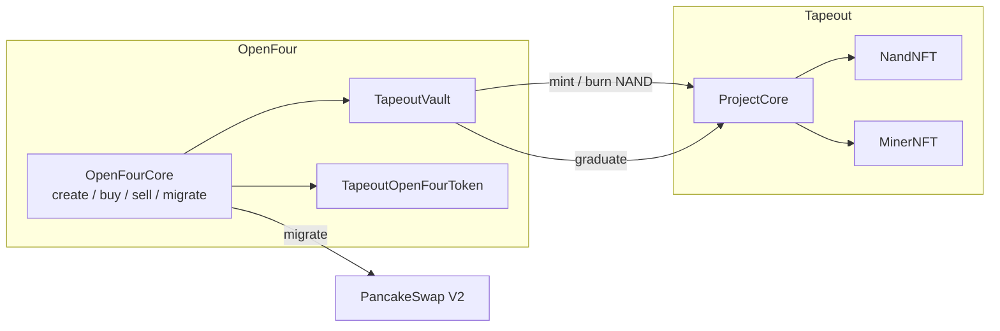

# TapeFour

[English](./tape-four.md) | [繁體中文](../zh-Hant/mechanisms/tape-four.md)

**TapeFour** is a meme mining mode built on the **Tapeout protocol**: raise funds by selling flat-price NAND pieces (NFTs), graduate the ERC20 to PancakeSwap V2, then tape out miners that earn the same token.

This page covers only this preset’s **distinct mechanics and integration caveats** (detection, internal-market NFT events, trading and fee boundaries). For create, quotes, shared events, and `encodedTags` parsing, see the [Integration Guide](../integration-guide.md).

`presetId = 1778027615734`

Tapeout ProtocolFactory (BSC): `0xa8d687fC59647f25A7c45c17753505f629468f4f`

---

## 1. Architecture



```text
Create  → ERC20 + Project (same tx: TokenCreated + ProjectCreated → nandNFT / minerNFT)
Trading → flat-price NAND NFT (Core.buy/sell → Vault ↔ ProjectCore)
Migrate → 50M token + 98% raise → PCS V2; 950M → ProjectCore; ACTIVE
After   → ERC20 external market; 5 NAND → 1 Miner → mine token
```

| Stage | Asset | Notes | vs normal mode |
|-------|--------|------|----------------|
| Create | **ERC20 token** | Creates `TapeoutOpenFourToken` (primary key remains the token address); **tax or zero-tax is set by the creator** | **Different**: same tx often also emits `ProjectCreated`, which **can** be used to join `nandNFT` / `minerNFT` / `projectCore` (not the only way) |
| Internal market | **Flat-price NAND NFT** | Users buy/sell fixed-price pieces (NFTs), not ERC20 balances; **ERC20 has no market price yet** | **Different**: trade asset is NFT; `tokenAmount = pieces×1e18`; inventory from `NandTransfer`; do not chart rising ERC20 candles |
| Graduate | **Migrate the token** | On sell-out, seed PCS V2 LP with token + raised quote; mining inventory to ProjectCore; **ERC20 price starts on PCS V2** | **Partly different**: still OpenFour migrate / PCS V2; split is 1%+1%+98% LP, plus **950M → ProjectCore** |
| Mining | **Mine token via NFT** | After tapeout, Miners (from consumed NAND) earn the ERC20 on Tapeout | **Different** (unique to this mode): normal bonding / tax tokens have no tapeout or Miner mining |

Total supply is fixed at **1B** tokens. Graduate split:

| Destination | Share / amount |
|-------------|----------------|
| PCS V2 LP (LP to dead address) | **5%** tokens (**50M**) + **98%** of raised quote |
| ProjectCore (mining emissions) | **95%** tokens (**950M**) |
| Protocol treasury | **1%** of raised quote |
| Creator (→ treasury if zero) | **1%** of raised quote |

---

## 2. Detection

Any one of:

| Method | Match |
|--------|--------|
| `presetId` | `TokenCreated.presetId == 1778027615734` |
| `encodedTags` | `token.tapeout` + `module.vault.tapeout` + (`module.trade.tapeout` or `module.trade.tapeout_whitelist`) |
| `descriptor()` | `token.descriptor().tag == "token.tapeout"` |

Tag list: Integration Guide §11.1. Migrate tag is **`module.migrate.tapeout_pcs_v2`**, not plain `pcs_v2`.

### Token type (tax / zero-tax)

The ERC20 is **`TapeoutOpenFourToken` (extends `TaxToken`)**. Source in this repo: [`contracts/token/TapeoutOpenFourToken.sol`](../../contracts/token/TapeoutOpenFourToken.sol) (`descriptor().tag = "token.tapeout"`).  
Whether external transfer tax applies, and at what rate, is **fully set by the creator at create time** (`buyFeeRate` / `sellFeeRate`):

| Setting | Meaning |
|---------|---------|
| `buyFeeRate` / `sellFeeRate` **> 0** | After graduate, TaxToken transfer tax on pool-related transfers (**0–10%** each, i.e. 0–1000 bps) |
| Both **0** | **Zero-tax token**: no TaxToken transfer tax externally either |
| If either buy/sell tax is non-zero | `rateFounder` / `rateHolder` / `rateBurn` / `rateLiquidity` must sum to 100 |
| If both buy/sell tax are 0 | those rates may all be 0 |

Read on-chain: `token.buyFeeRate()` / `token.sellFeeRate()` (bps). **Do not** assume taxed or untaxed just from tag `token.tapeout`.

Fees are layered (inner market is independent of zero-tax):

| Phase | Fees |
|-------|------|
| Internal NAND buy/sell | OpenFour **protocol trade fees** only (`protocolFee` / `devFee`, etc.). **Never** TaxToken transfer tax (`TradeExecuted.taxFee = 0`) |
| External (after migrate) | TaxToken transfer tax **may** apply; **tax or zero-tax depends on creator settings** |

---

## 3. Internal-market events — special-case recommended

`nandNFT` / `minerNFT` / `projectCore` **can** be joined from the create tx via  
`TokenCreated.token == ProjectCreated.projectToken`. They can also be resolved later from `vault.projectCore()`, or from `projectTokenAddress` on `NandTransfer` / `MinerTransfer` — create-time joining is convenient, not a hard prerequisite.

`TradeExecuted` **still fires**, but the user-facing asset is **NAND NFT** (the flat unit price is the **NAND piece price**, not an ERC20 price). Same tx: `TradeExecuted` + N× `NandTransfer`; `qty = tokenAmount / 1e18` should equal minted/burned id count.

**During the inner market the ERC20 has no trade price**: fundraising fills do not create a token/quote market. The ERC20 only gets an external price after graduate migrate seeds **PCS V2**. UI / indexers should show NAND piece price and raise progress — **do not** treat `TradeExecuted.lastPrice` as the token market price.

For existing bonding pipelines: **do not** update ERC20 balances / rising-curve candles from `tokenAmount`; **do not** use `token.balanceOf`; NAND inventory only from `NandTransfer`, miner inventory only from `MinerTransfer`.

### 3.1 `OpenFourCore.TokenCreated` (create)

Contract: `OpenFourCore`. Same event shape as shared integration; Tapeout field meanings:

| Field | Tapeout meaning |
|-------|-----------------|
| `requestId` | off-chain correlation id |
| `presetId` | should be **`1778027615734`** |
| `creator` / `token` | indexed; `token` = ERC20 primary key |
| `name` / `symbol` / `tokenMetaUri` | metadata |
| `maxSupply` | fixed **`1_000_000_000e18`** (1B) |
| `saleAmount` | **NAND pieces × 1e18** (`nandCap * 1e18`) |
| `raiseAmount` | **total raise** = `nandPrice * nandCap` (quote) |
| `initialPrice` | flat **unit price** (quote per 1e18 token unit; typically from `raiseAmount / nandCap`) |
| `quoteAsset` | fundraising quote asset |
| `vault` | **TapeoutVault** (then `projectCore()`) |
| `curveModule` / `tradeModule` / `migrateModule` / `tokenModule` / `customData` | module instances (customData usually zero) |
| `flags` | bit0 = antiSniper |
| `encodedTags` | see §2; detect Tapeout |

Same tx usually also emits Tapeout `ProtocolFactory.ProjectCreated` — see next section.

### 3.2 `ProtocolFactory.ProjectCreated` (optional NFT join)

Contract: Tapeout **`ProtocolFactory`** (see deployments / `TapeoutTokenModule.tapeoutFactory()`).  
Signature:

```solidity
event ProjectCreated(
  uint256 indexed projectIndex,
  address indexed creator,
  address indexed projectCore,
  address projectToken,
  address nandNFT,
  address minerNFT,
  string tokenName,
  string tokenSymbol,
  uint256 nandPriceWei,
  uint256 nandCap,
  LiquidityMode liquidityMode,
  uint64 fundraisingStartTime,
  uint64 fundraisingEndTime
);
```

| Field | Meaning (OpenFour × Tapeout) |
|-------|------------------------------|
| `projectIndex` | Tapeout-side project index |
| `creator` | creator |
| `projectCore` | ProjectCore (tapeout / mining entry) |
| `projectToken` | = OpenFour ERC20 (join with `TokenCreated.token`) |
| `nandNFT` / `minerNFT` | per-project NAND / Miner contracts |
| `nandPriceWei` / `nandCap` | piece unit price (wei) / piece cap |
| `liquidityMode` / `fundraisingStartTime` / `fundraisingEndTime` | under OpenFour mode end time is usually max; trust chain |

**Can** be used for a one-shot `token ↔ nandNFT / minerNFT / projectCore` mapping; not required — resolve later via vault / NFT events if preferred.

### 3.3 `OpenFourCore.TradeExecuted` (fundraising / progress)

| Field | Tapeout meaning |
|-------|-----------------|
| `token` / `trader` / `presetId` | indexed; `token` = ERC20 primary key |
| `isBuy` | `true` = buy NAND, `false` = sell back |
| `quoteAsset` / `vault` | quote asset / TapeoutVault |
| `tokenAmount` | **pieces × 1e18** (not ERC20 inventory delta) |
| `curveQuoteAmount` | pre-fee trade quote |
| `traderQuoteAmount` | user paid / received (incl. protocol fees) |
| `lastPrice` | flat unit price (usually unchanged) |
| `protocolFee` / `devFee` / `antiSniperFee` | protocol-side fees |
| `taxFee` | **always 0** (no TaxToken tax internally) |
| `totalRaised` | vault raised after trade (quote) |
| `remainingForSale` | remaining sale after trade (still ×1e18 units) |

### 3.4 `NandNFT.NandTransfer` (inventory)

Contract: each project's **`nandNFT`** (not the Factory).  
Signature: `NandTransfer(address indexed from, address indexed to, uint256 indexed tokenId, address coreAddress, address projectTokenAddress)`  

`projectTokenAddress` = OpenFour ERC20 for joins. Index **`NandTransfer` topic0** — do not sweep IERC721 `Transfer`.

| from | to | Meaning |
|------|-----|---------|
| `0` | user | buy mint |
| user | `0` | sell burn (`burnForResale`) |
| A | B | secondary transfer (only after transfers allowed) |
| owner | `0` | consumed on tapeout (burn when 5 NAND → 1 Miner) |

OpenFour path does **not** emit native `NandPurchased`.

### 3.5 `MinerNFT.MinerTransfer` (miner inventory)

Contract: each project's **`minerNFT`**.  
Signature: `MinerTransfer(address indexed from, address indexed to, uint256 indexed tokenId, address coreAddress, address projectTokenAddress)`  

Same field layout as `NandTransfer`; use `projectTokenAddress` to join the ERC20. Index **`MinerTransfer` topic0** (distinct from `NandTransfer` and IERC721 `Transfer`) — do not sweep `Transfer`.

| from | to | Meaning |
|------|-----|---------|
| `0` | owner | mint after tapeout reveal (usually with ProjectCore `MinerCreated`) |
| A | B | miner transfer (only after transfers allowed) |
| owner | `0` | burn / cleanup (if a path emits it) |

`MinerTransfer` generally does **not** appear during fundraising; subscribe after graduate for tapeout / mining.

### 3.6 Graduate: `MigrateExecuted` / `OpenFourGraduated`

After sell-out (`remainingForSale == 0`), migrate may run via post-trade auto-migrate or an explicit `migrate`. Index the same tx together:

#### `OpenFourCore.MigrateExecuted`

Contract: `OpenFourCore`. Same shape as shared integration.

| Field | Tapeout meaning |
|-------|-----------------|
| `presetId` / `caller` / `token` | indexed; `token` = ERC20 primary key |
| `vault` / `migrateModule` | TapeoutVault / migrate module instance |
| `migrateTagId` | **`module.migrate.tapeout_pcs_v2`** (not plain `pcs_v2`) |
| `totalRaised` / `remainingForSale` | graduate snapshot (remaining should be 0) |
| `migratedDataVersion` | **`1`** for Tapeout |
| `encodedMigratedData` | **`abi.encode(address pair)`** (PCS V2 pair, same as normal V2) |

Same tx usually also emits `PhaseTransition(token, … → Migrated, …)` (trust on-chain phase).

#### `ProjectCore.OpenFourGraduated`

Contract: each project's **`projectCore`** (bridge path).

```solidity
event OpenFourGraduated(
  address indexed pair,
  uint256 totalRaised,
  uint64 graduatedAt
);
```

| Field | Meaning |
|-------|---------|
| `pair` | should match the pair decoded from `MigrateExecuted.encodedMigratedData` |
| `totalRaised` | fundraising snapshot |
| `graduatedAt` | graduate timestamp; emission window starts here |

Asset split: see §1 (1% treasury + 1% creator + 98% quote/50M → LP; 950M → ProjectCore).

---

## 4. Internal-market APIs (OpenFourCore)

### 4.1 Quotes (OpenFourTools)

Same as normal mode: quote with **`OpenFourTools`** before submit. Entry points unchanged; under Tapeout treat `amount` as **pieces × 1e18**:

```solidity
function estimateBuy(
  address token, address trader, uint256 amount,
  uint256 options, bytes calldata proof
) external view returns (TradeEstimate memory);

function estimateBuyByBudget(
  address token, address trader, uint256 maxQuotePayAmount,
  uint256 options, bytes calldata proof
) external view returns (TradeEstimate memory);

function estimateSell(
  address token, address trader, uint256 amount,
  uint256 options, bytes calldata proof
) external view returns (TradeEstimate memory);
```

| Return field | Tapeout meaning |
|--------------|-----------------|
| `tokenAmount` | estimated fill as pieces × 1e18 (esp. useful for buyByBudget) |
| `curveQuote` | pre-fee curve quote ≈ `pieces × unitPrice` |
| `totalFee` | protocol-side fees total (**no** TaxToken `taxFee` on the inner market) |
| `userPays` | quote the buyer pays (incl. fees); use for `maxPayAmount` |
| `userReceives` | quote the seller receives (after fees); use for `minReceiveAmount` |
| `executionPrice` | execution price view (usually near flat unit price) |

UI should show **pieces**; use `userPays` / `userReceives` for amounts. See Integration Guide quote sections for shared details.

### 4.2 Trade entry points and per-tx cap

Call the **same** `OpenFourCore` entry points as bonding; interpret parameters as Tapeout:

```solidity
function buy(
  address token, uint256 amount, uint256 maxPayAmount,
  uint256 options, bytes calldata proof
) external payable;

function buyByBudget(
  address token, uint256 maxPayAmount, uint256 minAmountOut,
  uint256 options, bytes calldata proof
) external payable;

function sell(
  address token, uint256 amount, uint256 minReceiveAmount,
  uint256 options, bytes calldata proof
) external;
```

| Param | Tapeout meaning |
|-------|-----------------|
| `token` | ERC20 primary key (`TapeoutOpenFourToken`), not the nandNFT address |
| `amount` (buy/sell) | **pieces × 1e18**; e.g. buy 3 pieces → `3e18` |
| **Max NAND per tx** | **buy / sell ≤ 100 pieces** (`amount ≤ 100e18`); above that TradeModule rejects |
| `maxPayAmount` / `minReceiveAmount` / `minAmountOut` | quote (or zapped native) slippage bounds; prefer §4.1 estimate then add/sub slippage |
| `options` | same as shared integration (native zap bits, etc.); see Integration Guide |
| `proof` (buy) | usually **`0x`** |
| `proof` (sell) | **`0x`**: vault picks last `qty` owned ids via `tokenOfOwnerByIndex`; or **`abi.encode(uint256[] tokenIds)`** for explicit NAND ids |

Before sell:

```solidity
nandNFT.setApprovalForAll(openFourCore, true);
```

(Approve **OpenFourCore**, not ERC20 `approve`.)

### 4.3 `buy`: non-whole pieces / oversize amounts

Unit: 1 NAND = `1e18`. Payment is only for the **filled** pieces (`userPays` = `curveQuote + protocol fees`). `TradeExecuted.requestedTokenAmount` may be the request; `tokenAmount` is the fill.

| Case | Result | Funds |
|------|--------|-------|
| `amount == 0` or `amount % 1e18 != 0` (not whole pieces) | **full revert** (curve `bad unit`) | **no charge** |
| `amount > 100e18` (over per-tx cap) | **full revert** (trade `max 100`) | **no charge** |
| whole pieces, ≤100, and ≤ remaining | fill requested pieces | charge `userPays`; ERC20 `transferFrom` exact amount; native/zap **refunds unused** `msg.value` |
| whole pieces, ≤100, but **> remaining** | FlatCurve **clamps to remaining** (`adjustedAmount`) | charge only for **filled** pieces; unfilled request is not charged |
| `maxPayAmount` < actual `userPays` | **full revert** (slippage) | **no charge** (native path refunds paid native) |
| `maxPayAmount` > actual `userPays` | fill | charge only due amount; surplus stays in wallet (ERC20 not over-pulled; native refunded) |

### 4.4 `buyByBudget`: budget not exactly one piece

Resolves the max **whole-piece** fill that fits the budget (incl. protocol fees), then pays like `buy`. Budget dust that cannot buy another whole piece is **not** taken.

| Case | Result | Funds |
|------|--------|-------|
| budget cannot afford **1 piece + fees** | **full revert** (`BudgetNotExecutable`) | **no charge** |
| budget buys N pieces (N≥1, ≤100, ≤ remaining) | fill N pieces | charge N-piece `userPays` only; leftover budget stays / native refunded |
| budget could buy more, limited by **remaining** | clamp to remaining pieces | same — charge filled pieces only |
| budget could buy more, limited by **100 / tx** | fill at most 100 pieces | same |
| resolved amount `< minAmountOut` | **full revert** (slippage) | **no charge** |

Compare: `buy` = “request pieces (may clamp to remaining)”; `buyByBudget` = “request spend, floor to whole pieces”. Neither fills a fractional NFT.

After graduate: `buy` / `sell` no longer apply for the inner market; trade ERC20 on PCS V2. TaxToken transfer tax from `buyFeeRate` / `sellFeeRate`. Tapeout / mining call Tapeout `ProjectCore`, not Core.
