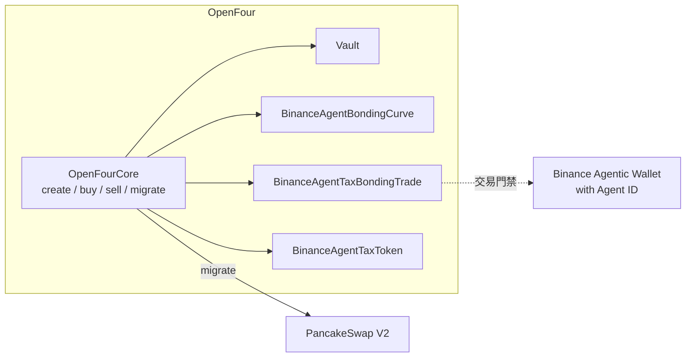

# Binance Agent ID Exclusive

[English](../../mechanisms/binance-agent-id-exclusive.md) | [繁體中文](./binance-agent-id-exclusive.md)

**Binance Agent ID Exclusive** 是 OpenFour 的 bonding preset，面向使用 **Binance Agentic Wallet with Agent ID** 的交易者。ERC20 為 **`BinanceAgentTaxToken`，繼承 `TaxToken`**：稅費收取、dispatch、founder 發放與 holder 領取與 TaxToken 相同；本模式另加 Agent 門禁（允許 0 稅、內盤轉帳鎖、持倉上限）。非預購單地址持倉上限為創建時 **`maxSupply × 1%`**。

本文覆蓋本 preset 特有機制，並摘要稅費與領取方式。通用建立 / 預估 / 事件見 [接入文件](../integration-guide.md)。稅費完整生命週期見 [TaxToken 稅費機制](./tax-token.md)。

`presetId = 1778027615735`

**要求：** 內盤買賣（除 creator 首塊預購外）需使用 **Binance Agentic Wallet with Agent ID**。  
**創建不限：** 創建者不需要 Agent ID，任意 EOA 均可創建。

參與本模式內盤交易，請使用 **Binance Agentic Wallet**，並領取 **Agent ID**。先開啟開發者模式：

```text
Binance App → Agentic Wallet Setting → Turn on Developer Mode
```

之後可透過 Binance Pro AI 對話等多種方式參與交易：

- [ai.binance.com](https://ai.binance.com)
- [Agentic Wallet / AI Pro 文件](https://web3.binance.com/en/dev-docs/products/agentic-wallet/ai-pro)

---

## 1. 架構




```text
Create  → 任意 EOA（不需 Agent ID）；可選 creator 首塊預購（≤ raise × 1.5%）
內盤    → Binance Agentic Wallet with Agent ID；持倉 ≤ maxSupply × 1%；轉帳鎖定
畢業    → PCS V2
之後    → 轉帳解鎖；DEX；若稅率 > 0 走 TaxToken 規則
```


| 階段         | 行為                                                            | 相對普通 Tax bonding         |
| ---------- | ------------------------------------------------------------- | ------------------------ |
| 建立         | 任意 EOA 可創建；**不需 Agent ID**；**允許 0/0 稅**                       | **有差別**：普通 Tax 模組常對賣稅設下限 |
| Creator 預購 | 創建同塊、僅 creator；`curveQuote ≤ raiseAmount × 1.5%`；**豁免** 1% 持倉 | **有差別**                  |
| 內盤買賣       | 需 **Binance Agentic Wallet with Agent ID**；非 creator 賣出同樣門禁   | **有差別**                  |
| 持倉上限       | 單地址餘額 ≤ 創建時 `maxSupply × 1%`；未滿則截斷退款；已滿則 revert               | **有差別**                  |
| 內盤轉帳       | 僅 Vault→用戶（買出）與 用戶→Vault（Core 賣入）；其餘 `TransferLocked`         | **有差別**                  |
| 畢業 / 外盤    | 解鎖轉帳；PCS V2；可選 TaxToken 轉帳稅                                   | 稅率 > 0 時外盤規則同 TaxToken   |


模組管線（Registry key）：


| 槽位         | Key / tag                                                                          |
| ---------- | ---------------------------------------------------------------------------------- |
| Token 模組   | `TOKEN_BINANCE_AGENT` → `module.token.binance_agent`                               |
| Curve      | `CURVE_BONDING_BINANCE_AGENT` → `module.curve.bonding_binance_agent`               |
| Trade      | `TRADE_TAX_BONDING_BINANCE_AGENT` → `module.trade.tax_bonding_binance_agent`       |
| Token impl | `TOKEN_IMPL_BINANCE_AGENT_TAX` → `BinanceAgentTaxToken`（`token.tax.binance_agent`） |


---

## 2. 識別

任一即可：


| 方法             | 匹配                                                                                                          |
| -------------- | ----------------------------------------------------------------------------------------------------------- |
| `presetId`     | `TokenCreated.presetId == 1778027615735`                                                                    |
| `encodedTags`  | `token.tax.binance_agent` + `module.curve.bonding_binance_agent` + `module.trade.tax_bonding_binance_agent` |
| `descriptor()` | `token.descriptor().tag == "token.tax.binance_agent"`                                                       |


**不要**當成普通 `token.tax` / `module.trade.tax_bonding`——Agent 使用專用 trade / curve / token tag。

---

## 3. 內盤交易門禁

Trade 模組：`module.trade.tax_bonding_binance_agent`。

### 3.1 誰可以交易


| 動作                 | 允許條件                                                                                      |
| ------------------ | ----------------------------------------------------------------------------------------- |
| Creator 首塊**預購買入** | Creator；與創建同塊；尚未開賣（`remainingForSale == saleAmount` 且 `totalRaised == 0`）；**不需** Agent ID |
| 其他買入               | 使用 **Binance Agentic Wallet with Agent ID**                                               |
| 賣出                 | Creator，或使用 **Binance Agentic Wallet with Agent ID**                                      |


### 3.2 Creator 預購上限

僅創建同塊的 creator 買入：

```text
curveQuote ≤ raiseAmount × 150 / 10_000   // 1.5%
```

超出 → `BinanceAgentTradeErrPresaleCap`。

### 3.3 單地址持倉上限（1%）

分母為創建時 **`maxSupply`**（curve 的 `totalSupply` / Core runtime `maxSupply`），**不是**之後鏈上 ERC20 `totalSupply()`。

```text
holdCap = maxSupply × 100 / 10_000   // 1%
```


| 情況                          | 行為                                                                   |
| --------------------------- | -------------------------------------------------------------------- |
| Creator 首塊預購                | **豁免** 1% 持倉上限，但預購金額最多為內盤目標募集資金 `raiseAmount` 的 **1.5%**（預購後持倉可超過 1%） |
| `balance < holdCap` 但本筆會超上限 | Curve 將買入量截到剩餘 room；按截斷量計價；多付 **退款**（不報 HoldCap）                     |
| `balance ≥ holdCap` 再買      | revert `BinanceAgentCurveErrHoldCap` / `BinanceAgentTradeErrHoldCap` |
| 預購之後再買（含 creator）           | 套用 1% 持倉上限，且須使用 Binance Agentic Wallet with Agent ID；無 Agent ID 的 creator 不可再次買入 |


精確買 `buy(amount)` 與預算買 `buyByBudget` 均受上限約束（預算路徑透過 trade `maxAmount`）。

---

## 4. 內盤轉帳鎖

Token：`BinanceAgentTaxToken`（`token.tax.binance_agent`）。

phase 為 **Created / Trading / SoldOut**（尚未 `MigratePending` / `Migrated`）時，`_transfer` 僅允許：


| 路徑    | `from` | `to`  | `msg.sender` |
| ----- | ------ | ----- | ------------ |
| 內盤買出貨 | vault  | 用戶    | vault        |
| 內盤賣入庫 | 用戶     | vault | Core         |


其餘轉帳（錢包互轉等）→ `BinanceAgentTokenErrTransferLocked`。

遷移解鎖後：走普通 TaxToken 轉帳規則（含可選的池相關買賣稅）。

---

## 5. Token 類型：繼承 TaxToken

`BinanceAgentTaxToken` **繼承 `TaxToken`**。descriptor tag 為 `token.tax.binance_agent`（不是普通 `token.tax`），但會計介面與 TaxToken 相同（`buyFeeRate`、`sellFeeRate`、`feeAccumulated`、`dispatchTax`、`claimFee` 等）。

相對普通 TaxToken 的差異：

| 項目 | Agent ID Exclusive |
|------|--------------------|
| 實作 | `BinanceAgentTaxToken` 繼承 `TaxToken` |
| 買賣稅下限 | 允許 **0** bps（普通 Tax preset 常對賣稅設下限） |
| 買賣稅上限 | 各 **1000** bps（10%） |
| 內盤轉帳 | 遷移前鎖定（見 §4）；不改變 bonding 成交時 quote 稅的入帳方式 |
| 稅費生命週期 | 稅率 > 0 時與 TaxToken 相同 |

創建時稅費參數（含義同 TaxToken）：

- `founder` — founder 稅收款地址；0 則預設為 creator
- `buyFeeRate` / `sellFeeRate` — **0–1000** bps
- `rateFounder`、`rateHolder`、`rateBurn`、`rateLiquidity` — 權重；任一邊稅 > 0 時總和須為 **100**；雙 0 稅時可全為 0
- `minShare` — 可參與 holder 獎勵的最低 token 持倉
- 可選 `taxVaultTypeId` / `taxVaultInitParams`（founder TaxVault）

---

## 6. 稅費機制與如何領取

當 **買賣稅皆為 0** 時，沒有 meme 稅可收或領（`TradeExecuted.taxFee = 0`）。協議 / 開發者費仍走 FeeRouter，與其他 preset 相同。

當 **稅率 > 0** 時，稅費收取與分配遵循 [TaxToken](./tax-token.md)。

### 6.1 Dispatch 門檻

任何人可呼叫：

```solidity
token.canDispatchTax();  // view 預檢
token.dispatchTax();     // 處理待分配稅金
```

兩個 dispatch 門檻由模組固定注入，創建者不可配置：

| 設定 | 數值 | 含義 |
|------|------|------|
| `minDispatch` | **50,000 tokens** | 畢業後，`tokenAccumulated > minDispatch` 時將累計 token 稅兌換成 quote，再按設定比例分發 |
| `minDispatchQuote` | **0.01 quote token** | `feeAccumulated >= minDispatchQuote` 時分配累計 quote 稅 |
| `minShare` | 創建者設定；最低／預設 **10,000 tokens** | 持倉低於此值的地址不參與 holder 獎勵 |

監聽 `DispatchReady`，呼叫 `dispatchTax()` 前先讀 `canDispatchTax()`。

### 6.2 分配去向

| 桶 | 行為 |
|----|------|
| Founder（`rateFounder`） | quote 付給 `founder`（若配置 TaxVault 則 best-effort `onERC20TaxReceived`）。原生 quote 會 unwrap 成 native |
| Holders（`rateHolder`） | 以 quote 計入 `feePerShare`（懶更新，不遍歷全部持倉） |
| Burn / Liquidity | 遷移前暫存；遷移後由 TokenHelper 回購銷毀 / 加 LP |

### 6.3 Holder 如何領取稅費獎勵

**Four.meme Keeper 會定時主動批量分發 holder 稅費獎勵，使用者通常不需要自行領取。** 獎勵會直接發送到各 holder 帳戶，不會發給 Keeper。

若某帳戶當前可領稅費過小，Keeper 會暫時跳過；獎勵會持續累積，達到分發條件後再由 Keeper 自動發放。使用者也可隨時透過 token 合約介面查詢並自行領取：

```solidity
token.claimableFee(account);  // 可領
token.claimedFee(account);    // 已領
token.claimFee();             // msg.sender 領給自己
```

Four.meme Keeper 使用批量介面：

```solidity
token.claimFee(accounts);
token.userCount();
token.users(index, count, minClaimable);  // 分頁候選
```

可索引 `FeeClaimed` / `FeeInsufficient`。Founder 份額在 dispatch 時發放（不是走 `claimFee`）。Gas / 批量細節見 [TaxToken §3–§7](./tax-token.md)。

### 6.4 手動注資 holder 獎勵（可選）

同 TaxToken：`manualFundHolderRewards`、`supportsManualRewards()`、`totalManualRewards()` — 僅注入 holder 桶。

---

## 7. 接入注意

1. **門禁 UX**：引導用戶使用 **Binance Agentic Wallet with Agent ID** 交易；用下表 Agent 錯誤提示。
2. **剩餘可買**：`holdCap - balanceOf(trader)`；接近上限時勿假設 `amount` 全額成交。
3. **餘額**：ERC20 `balanceOf` 有效。可畫 bonding ERC20 價格，但遷移前 P2P 轉帳會失敗。
4. **稅費 UI**：若 `buyFeeRate`/`sellFeeRate` > 0，暴露 `claimableFee` / `claimFee`，以及可選的 keeper `dispatchTax`（同普通 TaxToken）。

---

## 8. 自訂錯誤（selector）

| Error | Selector | 含義 |
|-------|----------|------|
| `BinanceAgentTradeErrOnlyAgenticWallet()` | `0x96ea0b74` | 非 Binance Agentic Wallet with Agent ID |
| `BinanceAgentTradeErrPresaleCap()` | `0x63d7653c` | 預購超過 raise × 1.5% |
| `BinanceAgentCurveErrHoldCap()` | `0xe8c402c1` | 精確買路徑；已達 1% |
| `BinanceAgentTradeErrHoldCap()` | `0x687d0d11` | Trade 守衛；已達 1% |
| `BinanceAgentTokenErrTransferLocked()` | `0xa6708f30` | 內盤非正規轉帳 |

預算買若估不出可執行量，可能表現為 Core `CoreErrBudgetNotExecutable` 而非 HoldCap。

---

## 9. 相關文件

- [接入文件](../integration-guide.md) — 建立、預估、事件、tag
- [TaxToken 稅費機制](./tax-token.md) — 完整收取、dispatch、領取、keeper、gas
- [開發文件](../developer-guide.md) — 模組 / preset 組合

