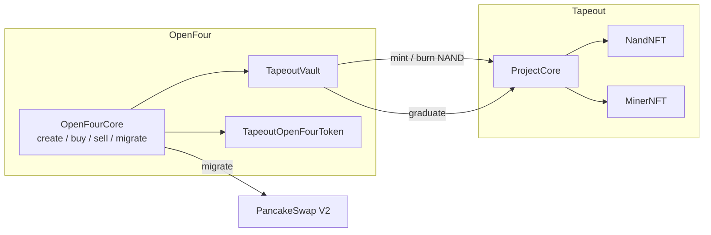

# TapeFour

[English](../../mechanisms/tape-four.md) | [繁體中文](./tape-four.md)

**TapeFour** 是一套基於 **Tapeout 協議**開發的 meme 挖礦模式：以固定單價募資 NAND 片（NFT），畢業後將 ERC20 遷移至 PancakeSwap V2，再透過流片礦機挖取同系列 token。

本文只覆蓋本 preset 的**特有機制與接入注意點**（識別方式、內盤 NFT 事件、交易與費用邊界）。建立、預估、通用事件與 `encodedTags` 解析等通用流程見 [接入文件](../integration-guide.md)。

`presetId = 1778027615734`

Tapeout ProtocolFactory（BSC）：`0xa8d687fC59647f25A7c45c17753505f629468f4f`

---

## 1. 架構



```text
Create  → 建 ERC20 + Project（同 tx：TokenCreated + ProjectCreated → nandNFT / minerNFT）
內盤    → 平價買賣 NAND NFT（Core.buy/sell → Vault ↔ ProjectCore）
畢業    → 50M token + 98% raise → PCS V2；950M → ProjectCore；ACTIVE
之後    → ERC20 外盤交易；5 NAND → 1 Miner → 挖取 token
```

| 階段 | 標的 | 說明 | 相對普通模式 |
|------|------|------|--------------|
| 建立 | **ERC20 token** | 創建的是 `TapeoutOpenFourToken`（主鍵仍是 token 地址）；**有稅 / 0 稅由創建者設定** | **有差別**：同 tx 常伴隨 `ProjectCreated`，**可用於**關聯 `nandNFT` / `minerNFT` / `projectCore`（非唯一途徑） |
| 內盤 | **平價 NAND NFT** | 使用者買賣的是固定單價的片（NFT），不是 ERC20 餘額；**ERC20 此時無市價** | **有差別**：成交物是 NFT；`tokenAmount = 片數×1e18`；持倉讀 `NandTransfer`，勿用 ERC20 餘額／勿畫 token 抬價 K 線 |
| 畢業 | **遷移 token** | 售罄後把 token + 募集資金組成 PCS V2 LP，並把排放庫存交給 ProjectCore；**此後 ERC20 才有外盤價格** | **部分差別**：仍走 OpenFour migrate / PCS V2；拆分為 1%+1%+98% LP，且 **950M → ProjectCore** |
| 挖礦 | **靠 NFT 挖 token** | 流片後用 Miner（由 NAND 消耗而來）在 Tapeout 側挖取 ERC20 | **有差別**（本模式獨有）：普通 bonding / 稅幣無流片與 Miner 挖礦 |

總供給固定 **10 億** token。畢業拆分：

| 去向 | 比例 / 數量 |
|------|-------------|
| PCS V2 LP（LP 打進死地址） | **5%** token（**50M**）+ 募集資金 **98%** |
| ProjectCore（挖礦排放） | **95%** token（**950M**） |
| Protocol treasury | 募集資金 **1%** |
| Creator（為 0 則歸 treasury） | 募集資金 **1%** |

---

## 2. 如何識別

任選其一即可：

| 方式 | 條件 |
|------|------|
| `presetId` | `TokenCreated.presetId == 1778027615734` |
| `encodedTags` | `token.tapeout` + `module.vault.tapeout` +（`module.trade.tapeout` 或 `module.trade.tapeout_whitelist`） |
| `descriptor()` | `token.descriptor().tag == "token.tapeout"` |

相關 tag 清單見接入文件 §11.1。遷移 tag 是 **`module.migrate.tapeout_pcs_v2`**，不是普通 `pcs_v2`。

### Token 類型（有稅 / 0 稅）

ERC20 實現是 **`TapeoutOpenFourToken`（繼承 `TaxToken`）**。源碼見本倉庫 [`contracts/token/TapeoutOpenFourToken.sol`](../../../contracts/token/TapeoutOpenFourToken.sol)（`descriptor().tag = "token.tapeout"`）。  
是否收外盤交易稅、收多少，**完全由創建者在創建時設定**（寫入 `buyFeeRate` / `sellFeeRate`）：

| 設定 | 含義 |
|------|------|
| `buyFeeRate` / `sellFeeRate` **> 0** | 畢業後外盤涉池轉帳收 TaxToken 交易稅（各 **0–10%**，即 0–1000 bps） |
| 兩者均為 **0** | **0 稅 token**：外盤也不收 TaxToken 轉帳稅 |
| 買賣稅不全為 0 時 | `rateFounder` / `rateHolder` / `rateBurn` / `rateLiquidity` 之和須為 100 |
| 買賣稅均為 0 時 | 上述 rate 可全 0 |

鏈上讀取：`token.buyFeeRate()` / `token.sellFeeRate()`（單位 bps）。**不要**因為 tag 是 `token.tapeout` 就假定一定有稅或一定無稅。

費用分兩層（與是否 0 稅無關的是內盤）：

| 階段 | 費用 |
|------|------|
| 內盤買賣 NAND | 只收 OpenFour **協議交易手續費**（`protocolFee` / `devFee` 等）；**一律不收** TaxToken 轉帳稅（`TradeExecuted.taxFee = 0`） |
| 外盤（畢業後） | 才可能收 TaxToken 交易稅；**有稅或 0 稅看創建者設定** |

---

## 3. 內盤事件：建議特判

`nandNFT` / `minerNFT` / `projectCore` **可以用**建立同 tx 的  
`TokenCreated.token == ProjectCreated.projectToken` 來關聯落庫；也可事後由 `vault.projectCore()`、或 `NandTransfer` / `MinerTransfer` 上的 `projectTokenAddress` 反查，不必把 create 關聯當成硬前置。

`TradeExecuted` **仍會發**，但使用者側成交物是 **NAND NFT**（Flat 單價是 **NAND 片價**，不是 ERC20 價）。同 tx：`TradeExecuted` + 若干 `NandTransfer`；`qty = tokenAmount / 1e18` 應等於 mint/burn 的 id 數。

**內盤期間 ERC20 沒有交易價格**：募集成交不形成 token/quote 市場；要等到畢業遷移進 **PCS V2** 後，ERC20 才有外盤價。UI / Indexer 內盤應展示 NAND 片價與募集進度，**不要**把 `TradeExecuted.lastPrice` 當成 token 市價。

對既有 bonding 管道：**不要**用 `tokenAmount` 更新 ERC20 持倉 / 畫抬價 K 線；**不要**用 `token.balanceOf`；NAND 持倉只認 `NandTransfer`，礦機持倉只認 `MinerTransfer`。

### 3.1 `OpenFourCore.TokenCreated`（建立）

合約：`OpenFourCore`。事件簽名與通用接入相同；Tapeout 下關鍵欄位語義如下。

| 欄位 | 說明（Tapeout） |
|------|-----------------|
| `requestId` | 鏈下關聯 id |
| `presetId` | 應為 **`1778027615734`** |
| `creator` / `token` | indexed；`token` = ERC20 主鍵 |
| `name` / `symbol` / `tokenMetaUri` | 元數據 |
| `maxSupply` | 固定 **`1_000_000_000e18`**（10 億） |
| `saleAmount` | **NAND 片數 × 1e18**（`nandCap * 1e18`） |
| `raiseAmount` | **總募集** = `nandPrice * nandCap`（quote） |
| `initialPrice` | Flat **單價**（quote / 1e18 token 單位；通常 = `raiseAmount / nandCap` 換算後） |
| `quoteAsset` | 募資報價資產 |
| `vault` | **TapeoutVault**（可再讀 `projectCore()`） |
| `curveModule` / `tradeModule` / `migrateModule` / `tokenModule` / `customData` | 模組實例（customData 多為 0） |
| `flags` | bit0 = antiSniper |
| `encodedTags` | 見 §2；用於識別 Tapeout |

同 tx 通常還有 Tapeout `ProtocolFactory.ProjectCreated`，見下節。

### 3.2 `ProtocolFactory.ProjectCreated`（可選關聯 NFT）

合約：Tapeout **`ProtocolFactory`**（地址見部署記錄 / `TapeoutTokenModule.tapeoutFactory()`）。  
簽名：

```solidity
event ProjectCreated(
  uint256 indexed projectIndex,
  address indexed creator,
  address indexed projectCore,
  address projectToken,
  address nandNFT,
  address minerNFT,
  string tokenName,
  string tokenSymbol,
  uint256 nandPriceWei,
  uint256 nandCap,
  LiquidityMode liquidityMode,
  uint64 fundraisingStartTime,
  uint64 fundraisingEndTime
);
```

| 欄位 | 說明（OpenFour × Tapeout） |
|------|---------------------------|
| `projectIndex` | Tapeout 側專案序號 |
| `creator` | 創建者 |
| `projectCore` | ProjectCore（挖礦 / 流片入口） |
| `projectToken` | = OpenFour ERC20（可與 `TokenCreated.token` join） |
| `nandNFT` / `minerNFT` | 該專案 NAND / Miner 合約 |
| `nandPriceWei` / `nandCap` | 片單價（wei）/ 片數上限 |
| `liquidityMode` / `fundraisingStartTime` / `fundraisingEndTime` | OpenFour 模式下募資截止通常為 max；以鏈上為準 |

**可用於**一次寫入 `token ↔ nandNFT / minerNFT / projectCore`；非硬前置，也可事後用 vault / NFT 事件反查。

### 3.3 `OpenFourCore.TradeExecuted`（募集 / 進度）

| 欄位 | 說明（Tapeout） |
|------|-----------------|
| `token` / `trader` / `presetId` | indexed；`token` = ERC20 主鍵 |
| `isBuy` | `true` 買 NAND，`false` 賣回 |
| `quoteAsset` / `vault` | 報價資產 / TapeoutVault |
| `tokenAmount` | **片數 × 1e18**（非 ERC20 持倉變化） |
| `curveQuoteAmount` | fee 前成交額（quote） |
| `traderQuoteAmount` | 使用者實付 / 實收（含協議費） |
| `lastPrice` | Flat 單價（通常不變） |
| `protocolFee` / `devFee` / `antiSniperFee` | 協議側費用 |
| `taxFee` | **恆為 0**（內盤無 TaxToken 稅） |
| `totalRaised` | 成交後累計募集（quote） |
| `remainingForSale` | 成交後剩餘可售（仍為 ×1e18 單位） |

### 3.4 `NandNFT.NandTransfer`（持倉）

合約：各項目自己的 **`nandNFT`**（不是 Factory）。  
簽名：`NandTransfer(address indexed from, address indexed to, uint256 indexed tokenId, address coreAddress, address projectTokenAddress)`  

`projectTokenAddress` = OpenFour ERC20，用來 join。訂 **`NandTransfer` topic0**，不要掃 IERC721 `Transfer`。

| from | to | 含義 |
|------|-----|------|
| `0` | user | 買入 mint |
| user | `0` | 賣出 burn（`burnForResale`） |
| A | B | 二級轉讓（僅允許轉讓後） |
| owner | `0` | 流片消耗（5 NAND → 1 Miner 時 burn） |

OpenFour 路徑**不會**發原生 `NandPurchased`。

### 3.5 `MinerNFT.MinerTransfer`（礦機持倉）

合約：各項目自己的 **`minerNFT`**。  
簽名：`MinerTransfer(address indexed from, address indexed to, uint256 indexed tokenId, address coreAddress, address projectTokenAddress)`  

欄位含義與 `NandTransfer` 相同；`projectTokenAddress` 用來 join ERC20。訂 **`MinerTransfer` topic0**（與 `NandTransfer` / IERC721 `Transfer` 均不同），不要掃 `Transfer`。

| from | to | 含義 |
|------|-----|------|
| `0` | owner | 流片完成 mint（通常伴隨 ProjectCore `MinerCreated`） |
| A | B | 礦機轉讓（僅允許轉讓後） |
| owner | `0` | burn / 清理（若路徑觸發） |

內盤募資階段一般**不會**出現 `MinerTransfer`；畢業後流片 / 挖礦階段才需要訂閱。

### 3.6 畢業：`MigrateExecuted` / `OpenFourGraduated`

售罄後（`remainingForSale == 0`）可由成交後 auto-migrate 或顯式 `migrate`。同交易建議一起索引：

#### `OpenFourCore.MigrateExecuted`

合約：`OpenFourCore`。簽名與通用接入相同。

| 欄位 | 說明（Tapeout） |
|------|-----------------|
| `presetId` / `caller` / `token` | indexed；`token` = ERC20 主鍵 |
| `vault` / `migrateModule` | TapeoutVault / migrate 模組實例 |
| `migrateTagId` | **`module.migrate.tapeout_pcs_v2`**（不是普通 `pcs_v2`） |
| `totalRaised` / `remainingForSale` | 畢業快照（此時剩餘可售應為 0） |
| `migratedDataVersion` | Tapeout 為 **`1`** |
| `encodedMigratedData` | **`abi.encode(address pair)`**（PCS V2 pair，與普通 V2 相同） |

同交易通常還有 `PhaseTransition(token, … → Migrated, …)`（以鏈上 phase 為準）。

#### `ProjectCore.OpenFourGraduated`

合約：各項目 **`projectCore`**（bridge 路徑）。

```solidity
event OpenFourGraduated(
  address indexed pair,
  uint256 totalRaised,
  uint64 graduatedAt
);
```

| 欄位 | 說明 |
|------|------|
| `pair` | 應與 `MigrateExecuted.encodedMigratedData` 解出的 pair 一致 |
| `totalRaised` | 募資總額快照 |
| `graduatedAt` | 畢業時間戳；排放窗口自此起算 |

資產拆分見 §1（1% treasury + 1% creator + 98% quote/50M → LP；950M → ProjectCore）。

---

## 4. 內盤交易接口（OpenFourCore）

### 4.1 預估（OpenFourTools）

與普通模式相同，提交前用 **`OpenFourTools`** 預估；入口不變，Tapeout 下把 `amount` 當 **片數 × 1e18**：

```solidity
function estimateBuy(
  address token, address trader, uint256 amount,
  uint256 options, bytes calldata proof
) external view returns (TradeEstimate memory);

function estimateBuyByBudget(
  address token, address trader, uint256 maxQuotePayAmount,
  uint256 options, bytes calldata proof
) external view returns (TradeEstimate memory);

function estimateSell(
  address token, address trader, uint256 amount,
  uint256 options, bytes calldata proof
) external view returns (TradeEstimate memory);
```

| 回傳欄位 | Tapeout 含義 |
|----------|--------------|
| `tokenAmount` | 預估成交片數對應的 ×1e18（buyByBudget 尤有用） |
| `curveQuote` | fee 前曲線額 = 約 `片數 × 單價` |
| `totalFee` | 協議側費用合計（內盤 **無** TaxToken `taxFee`） |
| `userPays` | 買入時使用者應付 quote（含費）；用來設 `maxPayAmount` |
| `userReceives` | 賣出時使用者應收 quote（扣費後）；用來設 `minReceiveAmount` |
| `executionPrice` | 執行單價口徑（Flat 下通常接近固定單價） |

UI 展示「片」；金額以 `userPays` / `userReceives` 為準，詳見接入文件預估章節。

### 4.2 成交入口與單筆上限

入口與普通 bonding **相同**，仍調 `OpenFourCore`；參數語義按 Tapeout 理解：

```solidity
function buy(
  address token, uint256 amount, uint256 maxPayAmount,
  uint256 options, bytes calldata proof
) external payable;

function buyByBudget(
  address token, uint256 maxPayAmount, uint256 minAmountOut,
  uint256 options, bytes calldata proof
) external payable;

function sell(
  address token, uint256 amount, uint256 minReceiveAmount,
  uint256 options, bytes calldata proof
) external;
```

| 參數 | Tapeout 含義 |
|------|----------------|
| `token` | ERC20 主鍵（`TapeoutOpenFourToken`），不是 nandNFT 地址 |
| `amount`（buy/sell） | **片數 × 1e18**；例：買 3 片 → `3e18` |
| **單筆最大 NAND** | **buy / sell 均 ≤ 100 片**（`amount ≤ 100e18`）；超出 TradeModule 拒絕 |
| `maxPayAmount` / `minReceiveAmount` / `minAmountOut` | quote（或 zap 後原生）滑點邊界；建議先用 §4.1 預估再加/減滑點 |
| `options` | 與通用接入相同（原生 zap 等位）；見接入文件 |
| `proof`（buy） | 一般 **`0x`** |
| `proof`（sell） | **`0x`**：vault 用 `tokenOfOwnerByIndex` 取持倉末尾 `qty` 個 id；或 **`abi.encode(uint256[] tokenIds)`** 指定要賣的 NAND |

賣出前必須：

```solidity
nandNFT.setApprovalForAll(openFourCore, true);
```

（授權給 **OpenFourCore**，不是 ERC20 `approve`。）

### 4.3 `buy`：`amount` 非整片 / 超額時怎麼辦

單位：1 NAND = `1e18`。實際扣款只按**成交片數**對應的 `userPays`（`curveQuote + 協議費`）；`TradeExecuted.requestedTokenAmount` 可能是請求值，`tokenAmount` 才是成交值。

| 情況 | 結果 | 資金 |
|------|------|------|
| `amount == 0` 或 `amount % 1e18 != 0`（非整片） | **整筆 revert**（curve `bad unit`） | **不扣款** |
| `amount > 100e18`（超過單筆上限） | **整筆 revert**（trade `max 100`） | **不扣款** |
| `amount` 整片且 ≤100，且 ≤ 剩餘可售 | 按請求片數成交 | 扣 `userPays`；ERC20 只 `transferFrom` 精確應付額；原生 / zap **退回多餘** `msg.value` |
| `amount` 整片且 ≤100，但 **> 剩餘可售** | FlatCurve **夾到剩餘**後成交（`adjustedAmount`） | 只按**實際成交片數**扣款；多要的片數不成交、不多收費 |
| `maxPayAmount` < 實際 `userPays` | **整筆 revert**（slippage） | **不扣款**（原生路徑會退回已付 native） |
| `maxPayAmount` > 實際 `userPays` | 成交 | 只收應付額；多餘預算**留在錢包**（ERC20 不會多轉；native 退回） |

### 4.4 `buyByBudget`：預算不是剛好 1 片時怎麼辦

先按預算（含協議費）反解出最大可買**整片**數，再走與 `buy` 相同的扣款路徑。預算裡「買不起下一整片」的餘額**不會**被收走。

| 情況 | 結果 | 資金 |
|------|------|------|
| 預算連 **1 片 + 費** 都買不起 | **整筆 revert**（`BudgetNotExecutable`） | **不扣款** |
| 預算剛好可買 N 片（N≥1，且 ≤100、≤剩餘） | 成交 N 片 | 只扣 N 片對應 `userPays`；多出的預算餘額留在錢包 / native 退回 |
| 預算理論可買很多，但受 **剩餘可售** 限制 | 夾到剩餘片數後成交 | 同上，只按實際片數扣款 |
| 預算理論可買很多，但受 **單筆 100 片** 限制 | 最多成交 100 片 | 同上 |
| 反解出的片數 `< minAmountOut` | **整筆 revert**（slippage） | **不扣款** |

對照：`buy` 是「指定片數（可被剩餘夾短）」；`buyByBudget` 是「指定花多少，向下取整到整片」。兩者都**不會**賣半片 NFT。

畢業後：`buy` / `sell` 不再走內盤；外盤走 PCS V2 路由 ERC20。TaxToken 轉帳稅讀 `buyFeeRate` / `sellFeeRate`。流片 / 挖礦調 Tapeout `ProjectCore`，不在 Core。
